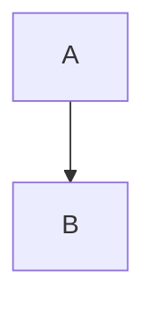

# Mermaid diagrams

Fenced blocks tagged `mermaid` are rendered as diagrams in pretty-print mode:

````markdown

````

## How it works
1. `md-core` renders the block as `<pre lang="mermaid"><code>…</code></pre>` and sets `Rendered::needs_mermaid`.
2. The viewer marks the page `data-mermaid="1"` **only** for documents that contain a diagram.
3. `assets/app.js` then loads `/__mdv/vendor/mermaid.min.js` (served from the binary; no network),
   renders each block to SVG with `securityLevel: 'strict'`, and picks the dark or default theme
   to match the system. Documents without diagrams never load the 3.5 MB script.
4. If the script is missing or a diagram has a syntax error, the source stays visible as a code block.

## Lean build
```
cargo build --release --no-default-features   # no embedded mermaid, ~3.5 MB smaller
```
The default (`mermaid` feature) includes it; releases are built with the default features.
Lean builds show diagrams as plain code blocks.

## Testing
- `cargo test -p md-viewer` — serving, feature gating, and "script only requested for diagram docs".
  `cargo test -p md-viewer --no-default-features` covers the lean build.
- `cd tests/js && npm install jsdom@24 && node mermaid-parse.mjs` parses every block in
  `docs/examples/mermaid.md` with the vendored bundle (also run in CI). Parsing does not need
  layout, so **visual** correctness (sizes, themes) still needs a manual check in the real window:
  `md-viewer docs/examples/mermaid.md`, in light and dark system themes.
