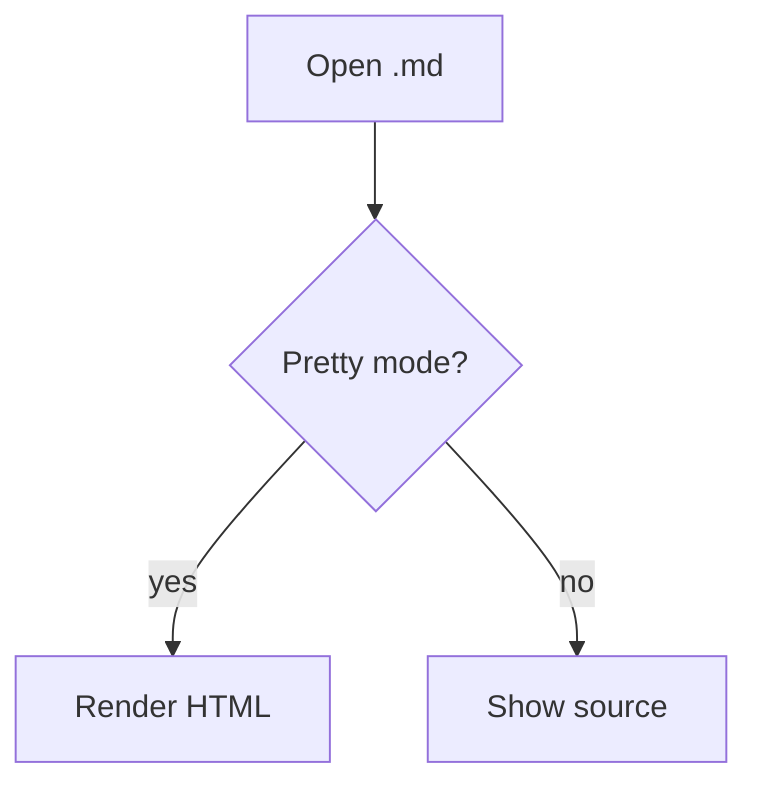
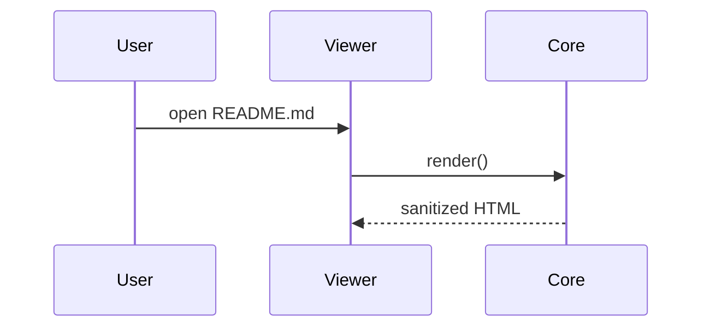
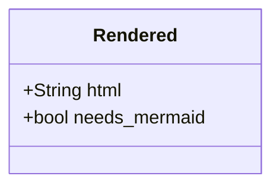
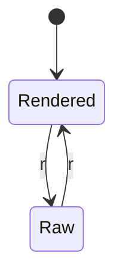
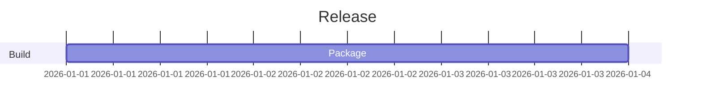
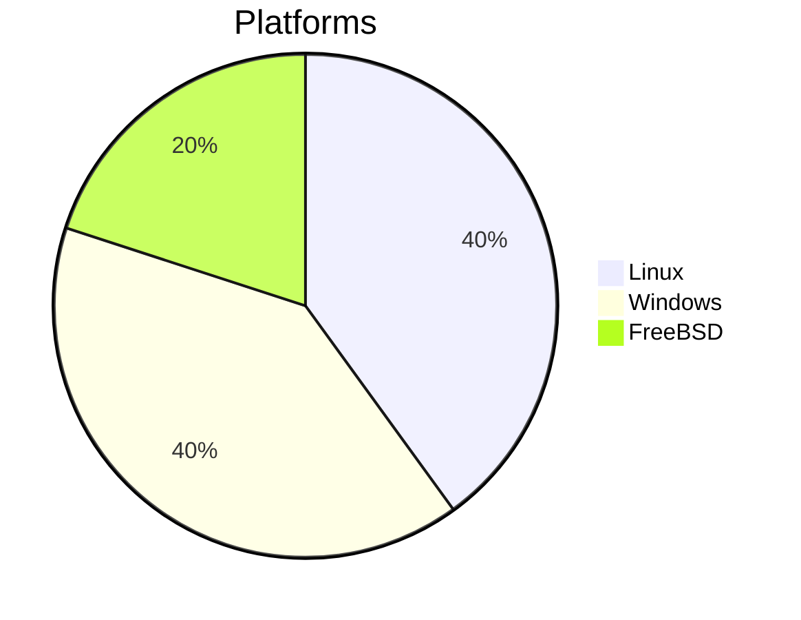

# Mermaid diagram examples

Used for manual checks and by `tests/js/mermaid-parse.mjs`. Each fenced block must render.

## Flowchart



## Sequence



## Class



## State



## Gantt



## Pie



## Not a diagram (must stay code)

```text
graph TD; A-->B
```
